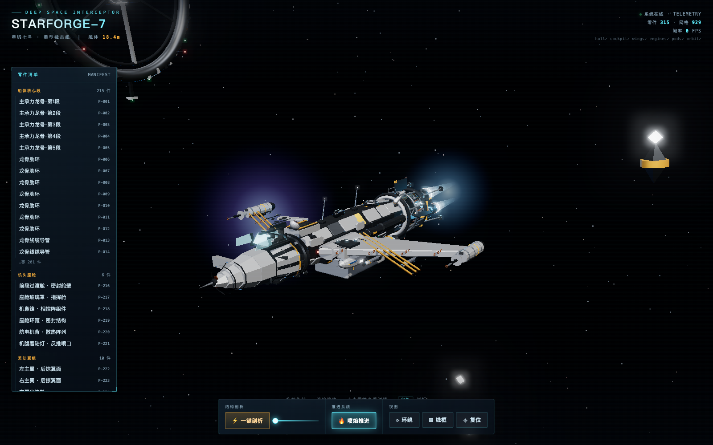
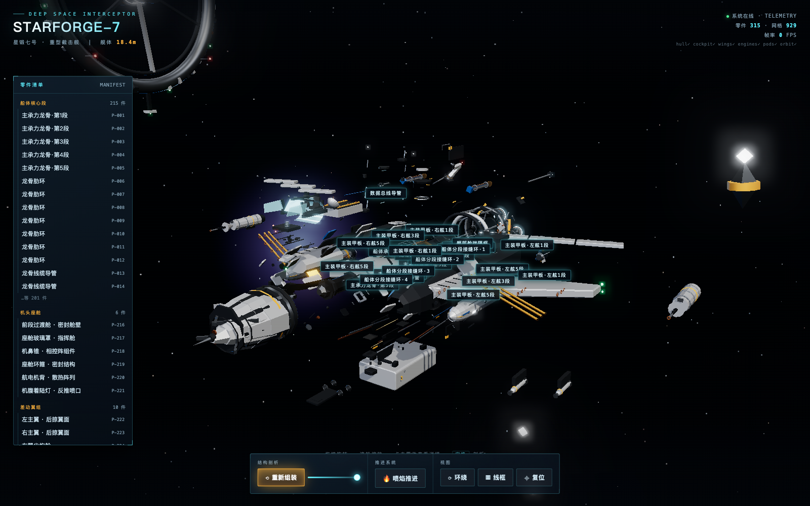
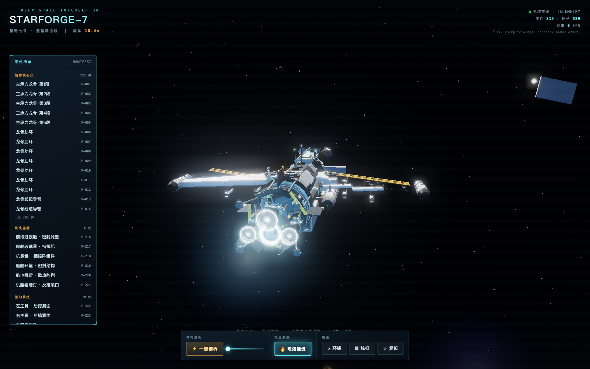

# STARFORGE-7 · 星锻七号 — 3D 飞船拆解演示

一个**单文件、零依赖、可离线运行**的 photorealistic 3D 飞船网页：重型拦截舰「星锻七号」，支持一键爆炸拆解、逐零件点选查看、推进喷焰与轨道环境。



## 直接打开

下载 [`starforge-7.html`](starforge-7.html)（约 770 KB，three.js 已全部内联），双击用任意现代浏览器打开即可 —— 无需服务器、无需网络、无 CDN。

## 功能

| 操作 | 说明 |
|---|---|
| ⚡ **一键剖析** | 315 个零件按各自方向缓动散开/复位，可用滑杆控制剖析进度 |
| 点击零件 | 高亮 + 信息卡 + 3D 投影标签，左侧清单可按模块定位 |
| 🔥 喷焰推进 | 自定义 shader 喷焰：马赫环激波菱形、湍流扰动、脉动辉光 |
| ⟳ 环绕 / 拖拽 / 滚轮 | OrbitControls 阻尼环绕、缩放 |
| ▦ 线框 / ⌖ 复位 | 材质线框切换、相机飞回主视角 |
| 空格键 | 快速切换爆炸/组装 |



## URL 调试参数

`starforge-7.html?pose=explode&flame=0&ui=0&view=back`

- `pose=explode` — 打开即爆炸
- `flame=0` — 关闭喷焰
- `ui=0` — 隐藏全部 HUD，纯场景
- `view=hero|front|side|top|back` — 预设机位
- `still=1` — 关闭自动环绕与舰体浮动
- `env=0` — 不加载轨道环境（单独检视舰体）

## 场景构成

- **六个模块化组件**：船体核心段（龙骨/装甲板/桅杆/散热鳍）、机头座舱、差动翼组、主推进组（3×离子引擎 + 聚变堆）、功能短舱（燃料舱/货舱/机械臂/通讯架）、轨道环境（空间站环/行星/碎片带）
- **渲染**：three.js r160 · ACESFilmic 色调映射 · PCFSoft 软阴影 · PMREM 环境反射 · UnrealBloom 辉光后期
- **飞船规格**：约 18.4 m，+Z 艏 · +Y 背 · 全部随机种子化，重建结果确定一致



## 源码结构

```
src/
  index.html        # UI 外壳（HUD/清单/底部控制坞）
  main.js           # 总装：材质库/光照/后期/爆炸系统/喷焰/点选标注
  modules/
    hullCore.js     # 船体核心段
    cockpit.js      # 机头座舱
    wings.js        # 差动翼组
    engines.js      # 主推进组
    pods.js         # 功能短舱
    orbitRing.js    # 轨道环境（空间站/行星/碎片）
build.mjs           # esbuild 打包 → 单文件 starforge-7.html
```

## 本地构建

```bash
npm install
npm run build      # 生成 starforge-7.html
```

（`package.json` 中 build 脚本调用 `node build.mjs`。）
